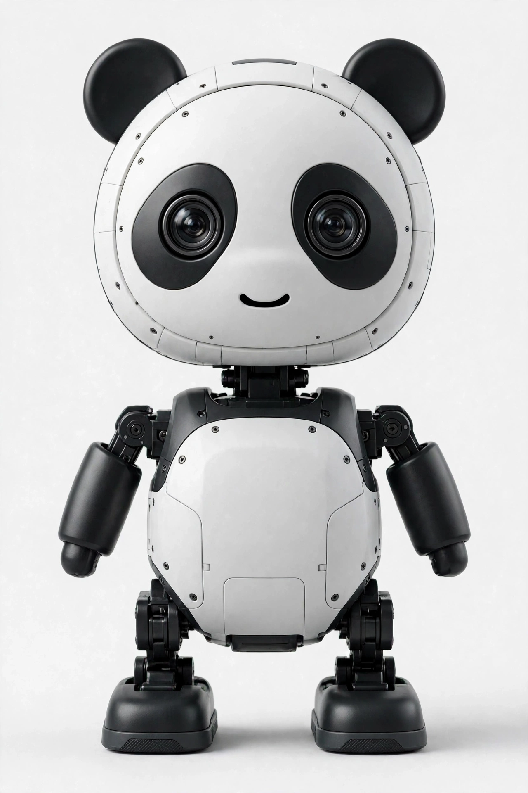
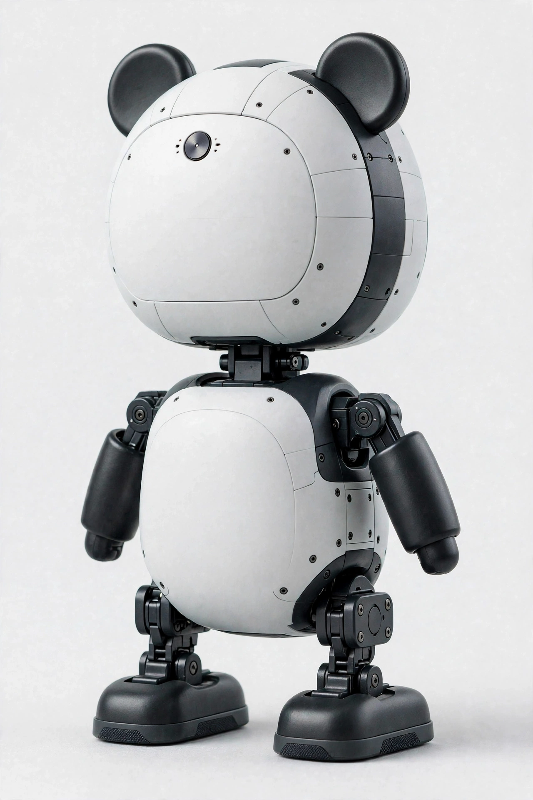

# Panda Robot — legged home agent on STS3215 servos

A small **walking panda robot** that lives in the house: it walks, sees, hears,
talks, and runs a home-agent brain. Built on the **Open Duck Mini v2**
architecture (Antoine Pirrone's open-source biped) with a panda body, a
Raspberry Pi 5 brain, and a Kendryte K230 vision co-processor as its eyes.

Design mass target ~2.1 kg (3 kg hard ceiling — the servo torque budget).
This repo holds the proposal, the current build status, the shopping list,
and the detailed assembly/wiring design.

## The idea

- **Body:** Open Duck Mini v2 legged platform — 14 bus servos, RL walking
  policy retrained for the panda's mass distribution (duck policies do not
  transfer directly).
- **Brain:** Raspberry Pi 5 (8 GB, already owned) running the Hermes home
  agent (OpenClaw fallback). LLM via OpenRouter; speech-to-text on the
  household Jetson (Whisper). The walking/safety layer runs independently of
  the agent — if the brain crashes, the legs don't.
- **Eyes:** Kendryte **K230 with two small cameras** — a stereo pair at the
  panda's eye positions. Face detection/tracking runs on the K230 itself; it
  sends results to the Pi over UART, so vision costs the Pi nothing.
- **Voice out:** MAX98357A I2S amp + 4 Ω 3 W waterproof speaker.
- **Power:** 4 × high-drain 18650 in 2S2P (7.4 V, ~44 Wh), HW-391 balanced
  BMS, Pololu 5 V buck for the Pi. Charging is **magnetic, not plug-in**: a
  charging cable connects to one half of a pre-wired magnetic pogo pair
  (already bought); the other half sits on the robot and feeds the IP2326
  charger inside. The halves touch → it charges. A printed holder keeps the
  cable-side half in place — no dock electronics. Hand-park for now;
  self-docking comes later.

## Look & proportions — design target (locked 2026-11-16)

Reference renders (local project files): `panda-look-master-front.webp`,
`panda-look-master-angle.webp`, `panda-look-master-stretched.webp`.

- **Style:** robotic hard panels, visible screws and servo joints.
  **No plush/soft shell** — rejected on weight.
- **Total height ~35 cm.** Head ~15 cm, trunk ~9–10 cm, legs 11–13 cm.
- **Head:** oversized (about half the height), hollow panel shell so the
  size costs almost no weight. White face panel, black round ears.
- **Eyes are the cameras:** one lens centred in each black eye patch —
  CanMV K230 (full-size) + two small cameras behind the patches.
  Eye spacing sets the stereo baseline.
- **Ears** ride on the MG90S servos (they wiggle). **Microphone array:**
  a ReSpeaker Flex circular ring on the head (processor board in the
  trunk); ear mics stay parked for later — he already owns small mics.
- **Mouth:** a small smiling slot, doubling as the speaker grille.
- **Trunk:** white belly panel over the Pi 5 + 2S2P pack; short black stub
  arms, fixed (no servos).
- **Legs: under 15 cm as a whole** (hip to floor, foot included) — the
  floor is set by stacking three STS3215 bodies per leg, not by the links.
  Legs must read shorter than the trunk. **Small-step gait** is the design
  assumption — no big strides needed. Full knee extension is a standing
  pose (+~2–3 cm), not the walking posture.
- **Feet:** big, flat, black, with the soft sole layer (neoprene) under.
- **Colours:** black / white PLA Matte (on hand).

## Key design decisions (all settled 2026-11-15)

| Area | Decision |
|---|---|
| Servos | 14 × Feetech STS3215-C001 **7.4 V** (5 per leg, 4 neck/head) + 2 × MG90S ear servos |
| Servo control | Waveshare Bus Servo Adapter (A), USB/UART from the Pi |
| IMU | Adafruit BNO055 (STEMMA QT 4646) in the trunk — the Duck's native IMU |
| Feet | 4 × SS-10 pin-plunger contact switches, 2 per foot |
| Battery monitor | INA226 ±20 A module (already owned) |
| 5 V rail | Pololu D36V50F5 buck (full pack range usable, no early cutoff) |
| Eyes | **K230 + 2 cameras** (stereo), UART results link to Pi GPIO 14/15 |
| Charging | Magnetic pogo pair inlet (bought for the old wheeled dock, reused); hand-park now, self-dock later |
| Not fitted (v1) | Lidar (weight), cliff sensors |

Superseded plans, for the record: an earlier wheeled self-balancing design
(2 × GIM4305 + GDZ34, 6 S pack, CAN HAT) was dropped on 2026-11-15 in favour
of the legged build; a Waveshare IMX219-83 stereo board for the eyes was
dropped because it does not physically fit the 104 mm head — the K230 pair
replaces it.

## Status — what we have now (2026-11-15)

- **Bought:** 4 × high-drain 18650 cells (30 A class); 3 × 6804ZZ bearings
  (hip-roll ×2, head-roll ×1) + tools; ReSpeaker Flex XVF3800 Circular-4
  mic array (2026-11-17).
- **Reported done / in cart (checkout pending):** the 14 STS3215 servos,
  MG90S ears, Waveshare adapter, BNO055 + cable, SS-10 foot switches,
  M3 heat-set inserts (M3×5×5 ×50), M3 screw assortment, cable wrap/Dupont/USB.
- **Still to buy:** HW-391 BMS (pre-soldered-leads variant), Pololu buck
  (Pi Hut), 2S cell holders (series, 3-wire), IP2326 charger board, rocker
  switch, XT30 pre-wired pairs, Wago 221s, Loctite 243, **2 eye cameras**
  (OV5647 pair for the K230's expansion ports, 15 cm FPC), 2 × 64 GB A2
  microSD, Pi 5 Active Cooler, sole material (3 mm neoprene sheet
  recommended).
- **Already owned:** Pi 5 8 GB, Bambu Lab A1 mini (prints the shells),
  INA226, Sipeed mic array, **CanMV K230 (full-size, 85 × 56 mm, 31 g —
  confirmed in hand 2026-11-16)**, PLA (black/white/pink matte).
- **Design:** assembly + wiring design complete (see
  [assembly-design.md](assembly-design.md)); weight estimate 2.2–2.4 kg.
  Panda trunk is a redesign around the Pi 5 + pack; legs/hips/neck carry
  over from the Duck; head adapts the existing panda v3.5/v3.6 CAD.
- **Not started:** panda CAD changes, MJCF model, walking-policy training,
  K230 firmware (CanMV), Pi↔K230 protocol.

Full item-by-item list with specs and statuses:
[shopping-list.md](shopping-list.md)

## Still open

- Spares: 1 spare STS3215 recommended before first walks.
- Stair/cliff safety: no sensor solution on a walking build yet — a later
  policy/sensor problem, flagged not solved.

Resolved since: microphone = **ReSpeaker Flex XVF3800 Circular-4**
(decided 2026-11-17 — ring on the head, processor in the trunk, USB to
the Pi; the owned Sipeed array returns to spares and the trunk back
panel is free again; fit study resolutions note); charging port = back
of the head with a tall-post dock (fit study, resolutions note); lidar
= his RPLIDAR C1 is owned, but its placement is parked — his decision,
pending.

## Files

- `README.md` — this proposal + status (kept current)
- `shopping-list.md` — full parts list with specs, traps and buy status
- `assembly-design.md` — detailed assembly sequence, wiring/power map,
  weight budget, gap analysis, K230 evaluation (2026-11-16 report)
- `fit-study.md` — packaging study: does every board fit the locked 35 cm,
  head/trunk layouts, charging-port and lidar/mic-array placement
  (2026-11-16, with resolutions note)
